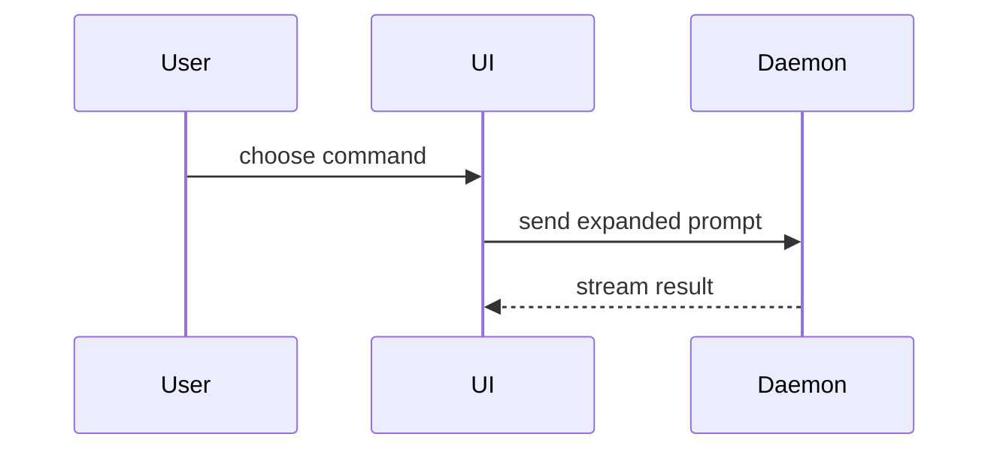

# Show Me：视觉化讲解

用视觉方式帮助用户理解当前讨论的主题。跳过开场白，文字保持简短。选能让关键点清晰成立的最小视图。

- 用伪代码展示逻辑或算法：

```text
on(save)
  if content is unchanged
    return cached result
  write new content
  return fresh result
```

- 用调用树展示运行时控制流：

```text
submitForm
  createSession
    persistPrompt
    launchAgent
  navigateToSession
```

- 用组件树展示 UI 结构，包含关键的状态与模块边界：

```tsx
<SessionPage> (apps/example/src/routes/session.tsx)
  useSessionEvents()
  <SessionToolbar>
    <RunSkillButton> (packages/ui)
```

- 用浅层文件树展示文件职责或大范围重构：

```text
src/
├── commands/       # 解析用户操作
├── sessions/       # 持有会话状态
└── transport/      # 发送 API 请求
```

- 用 Mermaid 展示组件交互、控制流或数据流：



  Mermaid 语法安全（使用习惯补充）：节点标签含特殊字符（`= : # ! { } < > ( ) []`）必须用 `["..."]` 双引号包裹，连接线标签同理；中文引号 `“” ‘’` 绝对禁止；节点 ID 必须字母开头且避开关键字。

- 当重点在“改了什么”且周边形态已存在时，用 `diff`，并让 diff 形态贴合主题。

组件变更：

```diff
 <SessionPage>
   useSessionEvents()
   <SessionToolbar>
+    <RunSkillButton />
   <SessionTimeline>
+    <SkillResultCard />
```

文件布局变更：

```diff
 src/
 ├── commands/
+│   └── show-me.ts       # 展开斜杠命令
 ├── sessions/
-└── transport.ts
+└── transport/
+    ├── client.ts
+    └── stream.ts
```

调用树 / 调用栈变更：

```diff
 submitForm
   createSession
     persistPrompt
+    expandSkillMention
     launchAgent
-  navigateToSession
+  navigateToSession
+    subscribeToEvents
```

状态或控制流变更：

```diff
 on(save)
-  write content
+  if content is unchanged
+    return cached result
+  write new content
+  invalidate cache
```

- 以下情况展示完整代码块：大部分内容是新的、省略上下文会掩盖归属或顺序、或用户需要一份可直接复制的目标形态：

```ts
function expandSkill(command: string): string {
  const skillName = command.slice(1)
  return `use the ${skillName} skill`
}
```

- 对视觉 UI、布局、状态对比，或 Mermaid 表达不了的高密度概念，写一个聚焦的 HTML 文件——示意图、信息图或短幻灯片，哪个贴合就用哪个。对齐产品的配色、字体、间距与组件；用真实标签和数据；支持桌面与移动端。然后为用户打开它：

```
Bash(open path/to/show-me-{description}.html)
```

### 使用指引

每个视图放在它支撑的那段短文字旁边。只保留回答用户当前问题、或解决当前讨论点所需的那几个调用、文件、props、状态与边界。

这些形式可以只用一种，也可以组合几种，不太可能全部用上。自行判断，别淹没用户。
